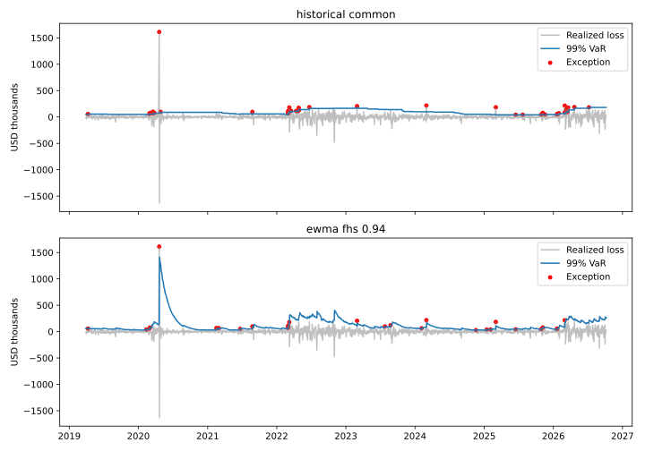

# Risk in a refiner's 3-2-1 hedge book

How much can a refiner's financial hedge lose in one day, and does a standard risk model get that number right?

**Short answer: the plain historical model misses too often, scaling it by recent volatility fixes most of that, and even the better model still fails one test.** A 99% one-day VaR should be exceeded about 1% of the time. The plain historical model was exceeded 2.16% of the time over 1,894 daily forecasts (2019 to October 2026). A volatility-scaled version (filtered historical simulation, "FHS") cut that to 1.43%, which passes the standard coverage test. But its misses still come in clusters (independence test p = 0.0058), which means it is slow to react when markets turn. I report both results; the model is better, not adequate.

The book is a stylized refiner's margin hedge: long 30 crude contracts, short 20 gasoline and 10 distillate. A hedge loss offsets a gain in the physical margin, so this is the risk of the hedge, not of the business.

## The comparison

All four models use the same **1,894 forecast dates, March 29, 2019 to October 7, 2026**, a 250-day estimation window and a 99% one-day VaR. "Exceptions" are days the loss was bigger than the forecast; the target rate is 1%. The coverage test asks whether the exception rate is consistent with 1%; the independence test asks whether exceptions are spread out rather than clustered. Higher p-values are better; 0.05 is the usual bar.

| Method | Average 99% one-day VaR | Exceptions | Exception rate | Coverage p | Independence p |
|---|---:|---:|---:|---:|---:|
| Historical | $91,609 | 41 | 2.16% | 0.000010 | <0.000001 |
| Normal | $124,398 | 43 | 2.27% | 0.000002 | <0.000001 |
| Weighted historical, decay 0.97 | $122,219 | 39 | 2.06% | 0.000050 | 0.0521 |
| **EWMA FHS, decay 0.94** | **$121,020** | **27** | **1.43%** | **0.0802** | **0.0058** |

FHS is the only model that passes coverage. It still fails independence: when one exception happens, another tends to follow, so the model is reacting late. Its average VaR is about 32% higher than the plain historical model's, which is the cost of recognizing more risk. Dropping the month-turn contract-roll days from training made coverage worse, so they stay in.



[Diagnosis and April 20, 2020](docs/backtest_diagnosis.md) · [Full model comparison](outputs/diagnosis_2026-10/model_comparison.csv) · [Exception ledger](outputs/diagnosis_2026-10/exception_ledger.csv)

## Why decay 0.94?

The volatility filter's decay was fixed at **0.94 before the results were seen**, because it is the standard RiskMetrics setting for daily data ([1996 Technical Document, §5.3.2](https://www.msci.com/documents/10199/5915b101-4206-4ba0-aee2-3449d5c7e95a)): yesterday's squared P&L gets a 6% weight and the memory half-life is about 11 trading days. The [first version of the diagnosis](https://github.com/akilatrades/energy-commodity-var-engine/blob/9a96c1594173d8de0b7af4895c91f8188bb141d6/run_diagnostics.py) already named 0.94 as primary and 0.97 and 0.99 as sensitivities; nothing was chosen by looking at p-values.

The sensitivities are reported anyway: coverage p-values are **0.080, 0.031 and 0.00005** for decays of 0.94, 0.97 and 0.99. Only the standard setting passes, and the slower filters do worse, which says the result depends on how quickly the model reacts.

## The book

A refiner buys crude and sells products, so the hedge that protects its margin is **long crude futures and short product futures**. When products rally, the hedge loses and the physical margin gains.

| Position | Contracts | Physical units |
|---|---:|---:|
| WTI crude (CL) | +30 | +30,000 bbl |
| RBOB gasoline (RB) | -20 | -840,000 gal = -20,000 bbl |
| Heating oil / distillate proxy (HO) | -10 | -420,000 gal = -10,000 bbl |

This represents the financial hedge of a stylized 30,000-barrel crude input yielding 20,000 barrels of gasoline and 10,000 barrels of distillate. The saved product-rally stress loses about $931,652 on the hedge while the matched physical margin gains.

## Saved evidence

The [October 2026 snapshot](outputs/sample_run_2026-10/README.md) contains 2,205 aligned Yahoo proxy prices through October 7, along with configuration, environment, checksums, point-in-time VaR/ES and stress results. Its original historical backtest has 42 exceptions in 1,954 forecasts (2.15%); the comparison above uses fewer dates because FHS needs a volatility warmup.

The [dated-contract study](docs/continuous_series.md) audits 48 Yahoo tickers and reconciles 250 real long-dated P&L intervals to the contract held. Roll adjustment lowers P&L volatility slightly; its reported 99% VaR is unchanged.

[Snapshot VaR/ES and stress results](outputs/sample_run_2026-10/executive_summary.md) · [Real-contract results](outputs/real_contract_roll_2026-10/comparison.csv)

## Models

- Historical, Normal, Student-t Monte Carlo, weighted historical and EWMA filtered historical VaR/ES.
- Component VaR, hypothetical stress, worst historical fixed-book days and an illustrative risk limit.
- Prior-only rolling forecasts with coverage and independence diagnostics.
- A contract-panel continuous-series builder with held-contract P&L reconciliation.
- A separate WTI producer option case study using European Black-76 full revaluation.

[Refiner thesis and signs](docs/refiner_hedge.md) · [Contract rolls](docs/continuous_series.md) · [Option risk](docs/nonlinear_risk.md)

## Companion: does the crack spread mean-revert?

[Refining margin project](projects/refining-margin/README.md) uses the same price snapshot to build the 3-2-1 crack spread and test a pre-specified mean-reversion rule. It finds no usable edge (51.7% hit rate, p = 0.68). Changes on the first trading day of each month are about 2.9 times normal size because the product contracts roll, and leaving them in, or making a one-day look-ahead error, would have produced a misleading result.

## Run it

```bash
pip install -r requirements.txt
pytest
python run_diagnostics.py
python run_real_contract_roll.py
```

Replay the saved prices or fetch a new public-data sample:

```bash
python run_analysis.py --mode snapshot --prices outputs/sample_run_2026-10/input_prices.csv --output-dir outputs/replay
python run_analysis.py --mode live --end 2026-10-08 --output-dir outputs/sample_run_2026-10
```

For an exact replay, use the configuration saved with the sample. Live mode fails on download errors. The offline demonstrations use labeled synthetic inputs:

```bash
python run_analysis.py --mode demo --output-dir outputs/demo
python run_option_risk.py
python run_roll_analysis.py --settlements examples/roll_fixture/settlements.csv --schedule examples/roll_fixture/schedule.csv --data-label "SYNTHETIC contract fixture" --output-dir outputs/roll_fixture
```

## What I learned / what I would do differently

Get the position signs and contract units right first; everything else sits on them. Then ask what the price history actually is: April 2020 showed that the continuous series I was using switched contracts at the worst moment, and the backtest showed that a model with no volatility memory misses too often. Those are two different problems with two different fixes.

Next I would buy expired-contract settlements so the roll is explicit rather than inferred, and keep scoring the fixed FHS model on new days instead of tuning it. For the options work, the missing inputs are observed volatility surfaces and physical basis.

The project's data, model and validation boundaries are collected in [Limitations](docs/limitations.md).
