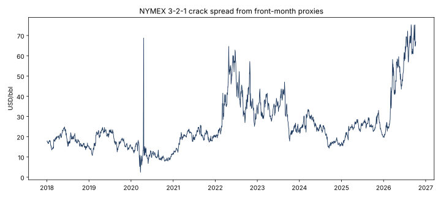

# Does the 3-2-1 crack spread mean-revert day to day?

**No usable edge.** A pre-specified mean-reversion rule on the NYMEX 3-2-1 crack spread was right on 51.7% of 563 active days and averaged $0.03/bbl per day (t = 0.42, p = 0.68), before costs. The hypothesis that a stretched crack snaps back the next day is not supported.

Two data problems would have hidden that answer:

- **Contract rolls.** Day-to-day crack changes are about 2.9 times larger on the first trading day of each month ($2.41/bbl versus $0.82/bbl), when the continuous RBOB and heating oil series switch delivery months. Leaving those days in raises the average result to $0.18/bbl per day. The extra profit is a roll artifact, not refining economics.
- **Look-ahead.** Setting the position with the next day's price, a one-line timing error, produces a t-statistic of −7.6. The rule appears to lose heavily, which would wrongly suggest strong momentum. The tests check that the signal at any date is unchanged when later prices change.



## The spread

A refiner turns three barrels of crude into roughly two barrels of gasoline and one of distillate. Per barrel of crude, in USD:

`3-2-1 crack = (2 × RBOB × 42 + 1 × heating oil × 42 − 3 × WTI) / 3`

RBOB and heating oil (NY Harbor ULSD) trade in USD/gal, so each is multiplied by 42 gallons per barrel.

| Year | Mean | 10th pct | 90th pct | Low | High |
|---|---:|---:|---:|---:|---:|
| 2018 | 18.19 | 15.04 | 21.69 | 13.45 | 24.81 |
| 2019 | 18.43 | 13.88 | 23.01 | 10.67 | 24.68 |
| 2020 | 11.26 | 8.35 | 14.89 | 2.40 | 68.77 |
| 2021 | 19.67 | 14.04 | 22.87 | 11.29 | 25.72 |
| 2022 | 38.46 | 23.10 | 54.45 | 19.45 | 64.63 |
| 2023 | 32.09 | 22.41 | 41.00 | 17.82 | 47.01 |
| 2024 | 22.83 | 16.06 | 29.89 | 14.37 | 33.52 |
| 2025 | 24.54 | 19.71 | 28.15 | 15.45 | 33.06 |
| 2026 (through Oct 7) | 50.36 | 24.55 | 68.56 | 19.65 | 75.31 |

USD/bbl. The 2020 high of $68.77 is April 20, when front-month WTI settled at −$37.63; it reflects that expiry, not refining margins.

## The test

The rule was fixed before it was run:

1. At each close, compare the crack with its trailing 60-day mean and standard deviation, using only prices through that day.
2. Short the crack when the z-score is above +1.5 and buy it below −1.5; otherwise stay flat.
3. Score the position on the next day's change in the crack.
4. Drop changes into the first trading day of each month and April 20–22, 2020.

| Test | Active days | Hit rate | Mean $/bbl/day | t | p |
|---|---:|---:|---:|---:|---:|
| **Primary** | **563** | **51.7%** | **0.03** | **0.42** | **0.68** |
| Excluding 2020 | 511 | 50.5% | 0.02 | 0.24 | 0.81 |
| Roll days left in | 594 | 52.0% | 0.18 | 1.49 | 0.14 |
| Look-ahead error, for illustration | 562 | 31.1% | −0.50 | −7.60 | <0.001 |

[Full results](outputs/signal_test.csv) · [Roll-day check](outputs/roll_day_check.csv) · [Daily cracks](outputs/crack_history.csv) · [Assumptions](outputs/assumptions.json)

## Data

`data/front_month_proxies_2018_2026.csv` is a copy of the price snapshot saved with the [October 2026 risk sample](../../outputs/sample_run_2026-10/README.md): Yahoo Finance continuous front-month proxies for CL, RB and HO, January 2, 2018 to October 7, 2026 (SHA-256 `953693721be113a6be424fd2b725705b80e37bfc5ef5b76fa42791baa065c87d`). How Yahoo builds these series is not documented, which is why roll days are handled by rule rather than by contract.

## Run it

From this directory:

```bash
pytest test_model.py
python run_analysis.py
```

## What I learned / what I would do differently

The most important step was not the signal. It was finding that one trading day a month carries crack changes nearly three times normal size because of contract switches, and that a single timing slip can manufacture a convincing result. I would rebuild the spread from dated contract settlements, matching the delivery month of each leg, and add the Gulf Coast product and crude basis a physical refiner actually sees before testing anything shorter-term.

## Limitations

These are futures proxies, not a refinery's realized margin: no product slate, yields, operating costs, RINs, or regional basis. The z-score window still contains roll-driven level shifts. Daily observations overlap in their 60-day windows, so the t-statistic is approximate. Results are before transaction costs and bid-ask spreads, which would likely erase the small positive average.
